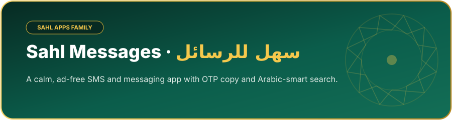

  

---

## ✨ Highlights

| Feature | What it gives you |
|---|---|
| 💬 **Clean Conversations** | Fast, clutter-free SMS inbox with instant search across Arabic and English messages. |
| 🔑 **One-Tap OTP Copy** | Detects verification codes automatically so you can copy them in a single tap. |
| 🚫 **Quiet Spam Filtering** | Keep unwanted promotional texts out of your main inbox. |
| 🌙 **Emerald & Gold Theme** | Supports Arabic RTL, Thmanyah Sans typography, light & dark modes, and Sahl Chime alerts. |

---

## 📲 Install in Seconds

1. Tap **[Download Latest APK](https://github.com/AliSherif1309/SahlMessages/releases/latest)** above.
2. Open the downloaded `.apk` file on your Android phone to install.
3. **Sahl Messages** checks for new versions automatically so you stay up to date in one tap.

---

## 🌿 The Sahl Apps Family · عائلة تطبيقات سهل

A calm, ad-free, bilingual (**Arabic & English**) suite of everyday Android apps crafted in **Emerald & Gold**:

[🎨 Sahl Theme](https://github.com/AliSherif1309/SahlHome) · [🕌 Sahl Adhan](https://github.com/AliSherif1309/SahlAdhan) · [🧭 Sahl Qibla](https://github.com/AliSherif1309/SahlQibla) · [📞 Sahl Phone](https://github.com/AliSherif1309/SahlPhone) · [👤 Sahl Contacts](https://github.com/AliSherif1309/SahlContacts) · [📷 Sahl Camera](https://github.com/AliSherif1309/SahlCamera) · [🖼️ Sahl Gallery](https://github.com/AliSherif1309/SahlGallery) · [📁 Sahl Files](https://github.com/AliSherif1309/SahlFiles) · [📄 Sahl PDF](https://github.com/AliSherif1309/SahlPDF) · [🛠️ Sahl Tools](https://github.com/AliSherif1309/SahlTools) · [☁️ Sahl Sync](https://github.com/AliSherif1309/SahlSync) · [📺 Sahl TV](https://github.com/AliSherif1309/SahlTV-Launcher)
